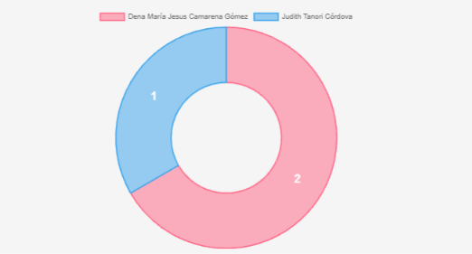

# sistema-votacion-unison — Votación en línea

**Creadores:**
- Anahí Hernández — [@annyie681](https://github.com/annyie681)
- Sebastián Ibarra — [@sebastianibar](https://github.com/sebastianibar)
- Josué Martínez — [@Lalocarrito](https://github.com/Lalocarrito)
- Celeste Román — [@mceless3](https://github.com/mceless3)

Simulación académica de una votación para la rectoría de la UNISON. Los estudiantes eligen
un candidato y emiten su voto; los resultados se ven en una gráfica de dona. Hecha en PHP y
MySQL.

## Requisitos y ejecución

- XAMPP (Apache + MySQL) o un servidor con PHP y MySQL

1. Copia la carpeta a `htdocs/votacion`.
2. Importa `votacion.sql` en phpMyAdmin.
3. Revisa los datos de `conexion.php`.
4. Abre `http://localhost/votacion/formulario.php`.

## Imágenes

| Votación | Resultados |
|---|---|
|  |  |
