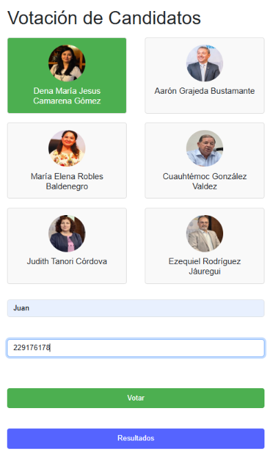
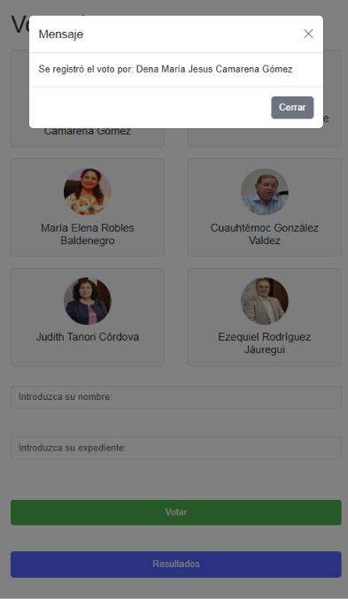

# sistema-votacion-unison - Sistema de votación en línea

> Aplicación web que simula una votación para elegir candidatos a la rectoría de la UNISON.

El estudiante captura su nombre y expediente, elige un candidato y emite su voto; una página
de resultados muestra los votos en una gráfica de dona que se actualiza sola.

> Proyecto de simulación con fines académicos. No usa datos reales de votantes.


---

## Tabla de contenido

- [Características](#características)
- [Capturas de pantalla](#capturas-de-pantalla)
- [Stack tecnológico](#stack-tecnológico)
- [Requisitos](#requisitos)
- [Instalación y ejecución](#instalación-y-ejecución)
- [Uso](#uso)
- [Estructura del proyecto](#estructura-del-proyecto)
- [Seguridad](#seguridad)
- [Autores](#autores)

---

## Características

- **Votar:** el estudiante escribe su nombre y expediente, elige un candidato (se resalta
  en verde al seleccionarlo) y presiona *Votar*.
- **Validación del expediente:** debe tener exactamente 9 dígitos, tanto en el formulario
  (`pattern`) como en el servidor.
- **Un voto por expediente:** si el expediente ya votó, se muestra un mensaje y el voto no
  se guarda.
- **Mensajes en un modal:** avisa si falta elegir candidato, si el expediente es inválido o
  repetido, o si el voto se registró.
- **Resultados:** gráfica de dona con los votos de cada candidato; la página se recarga
  sola cada 30 segundos.

## Capturas de pantalla

| Pantalla de votación | Candidato seleccionado |
|----------------------|------------------------|
|  |  |

| Voto registrado | Resultados |
|-----------------|------------|
|  |  |

## Stack tecnológico

| Capa           | Tecnología                                        |
|----------------|---------------------------------------------------|
| Backend        | PHP 8.1+ (`mysqli`)                               |
| Base de datos  | MySQL / MariaDB                                   |
| Frontend       | HTML, CSS y JavaScript                            |
| Diseño         | Bootstrap 5.3.3 (CDN)                             |
| Gráficas       | Chart.js + `chartjs-plugin-datalabels` (CDN)      |
| Servidor local | XAMPP (Apache + MySQL)                            |

## Requisitos

- [XAMPP](https://www.apachefriends.org/) (Apache + MySQL) o un servidor con PHP y MySQL.
- PHP 8.1 o superior con la extensión `mysqli`.

## Instalación y ejecución

1. Instala XAMPP e inicia **Apache** y **MySQL** desde su panel de control.
2. Descarga este repositorio y renombra la carpeta a `votacion`; cópiala dentro de
   `htdocs` (por ejemplo `C:\xampp\htdocs\votacion`).
3. Crea la base de datos: abre `http://localhost/phpmyadmin`, entra a la pestaña
   **Importar** y selecciona `votacion.sql`.
4. Revisa en `conexion.php` que los datos coincidan con tu MySQL local:

   ```php
   $servername = "localhost";
   $username   = "root";
   $password   = "";
   $dbname     = "votacion";
   ```

5. Abre en el navegador:
   - Votación: `http://localhost/votacion/formulario.php`
   - Resultados: `http://localhost/votacion/resultados.php`

## Uso

1. Abre `formulario.php`.
2. Haz clic en un candidato para seleccionarlo (se resalta en verde).
3. Escribe tu nombre y expediente, y presiona **Votar**.
4. El resultado del voto se confirma en un modal; abre `resultados.php` para ver la
   gráfica actualizada.


## Autores

- **Anahí Hernández** - [@annyie681](https://github.com/annyie681)
- **Sebastián Ibarra** - [@sebastianibar](https://github.com/sebastianibar)
- **Josué Martínez** - [@Lalocarrito](https://github.com/Lalocarrito)
- **Celeste Román** - [@mceless3](https://github.com/mceless3)

